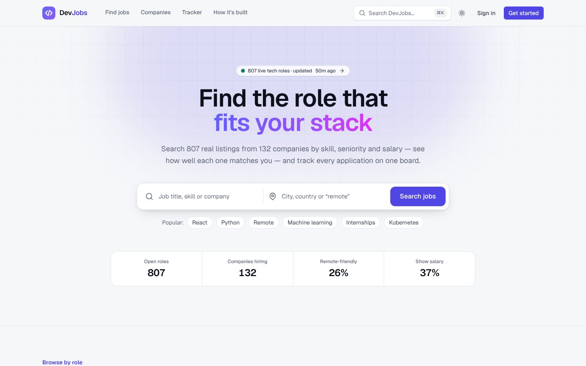
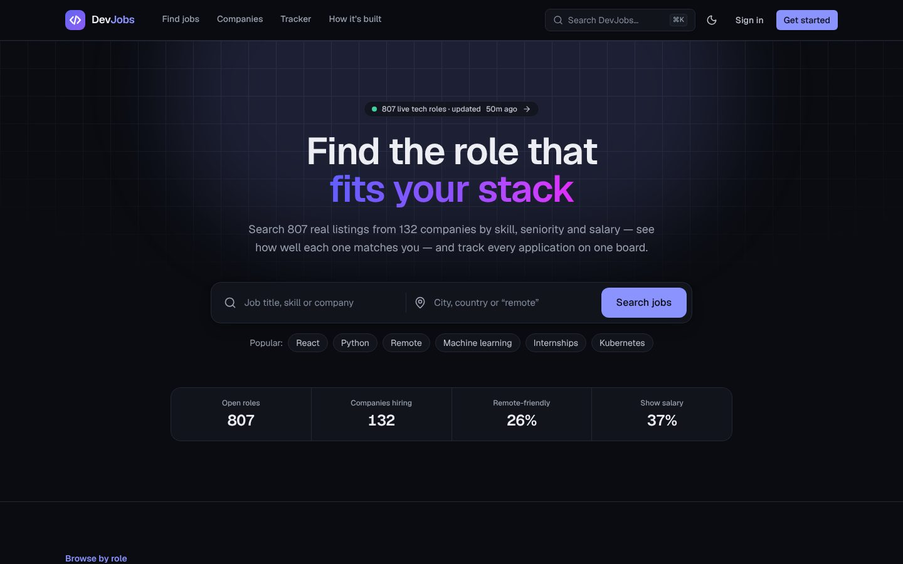
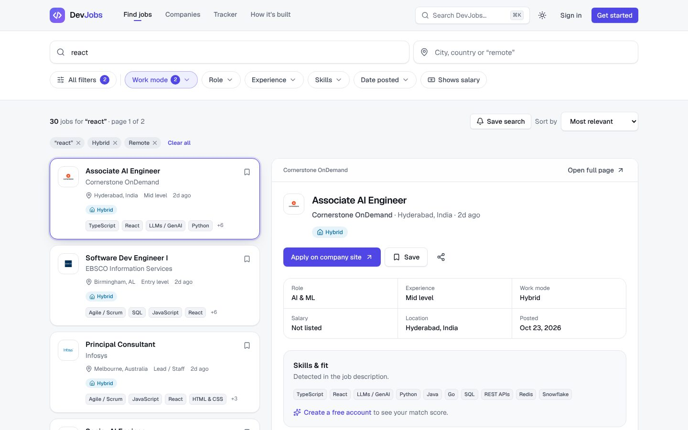
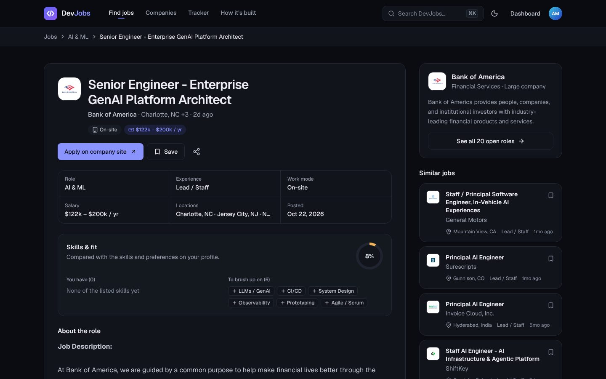
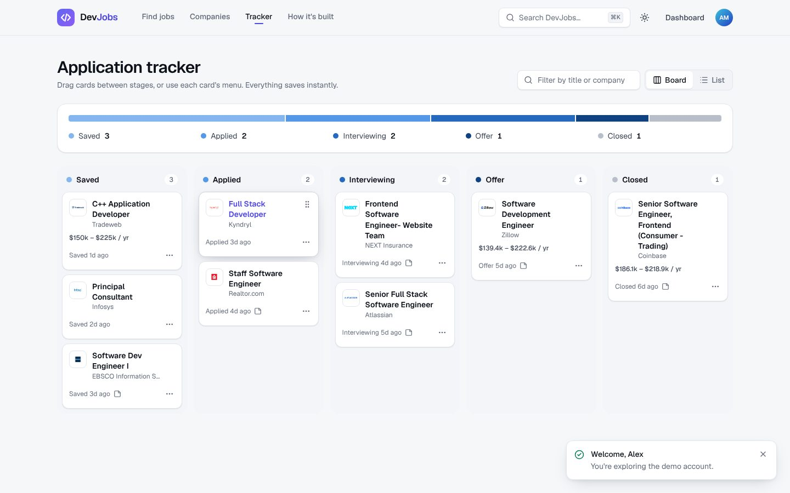
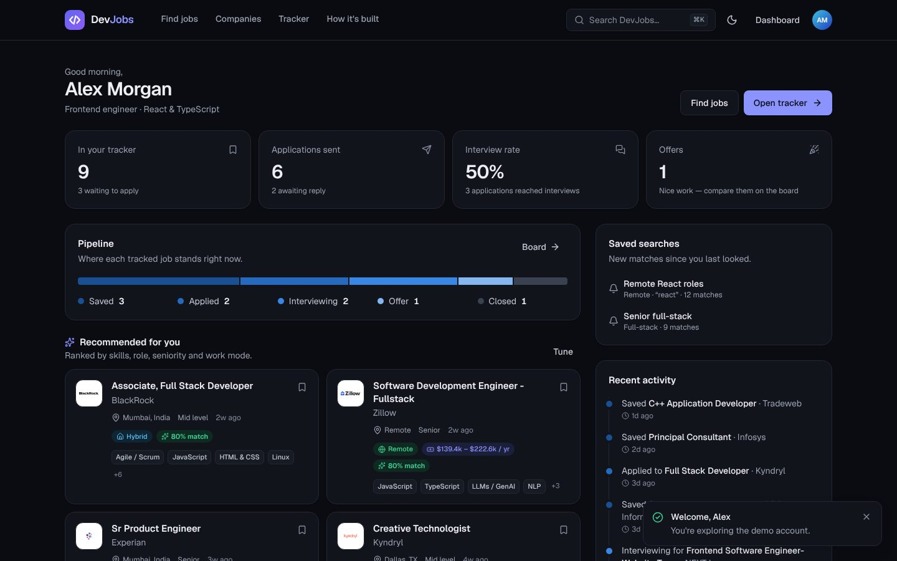
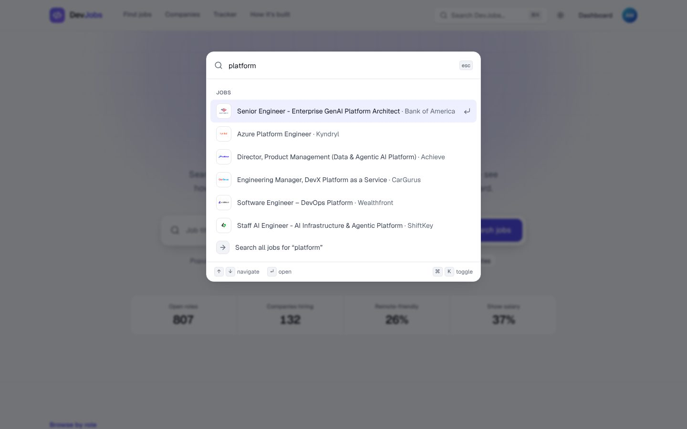
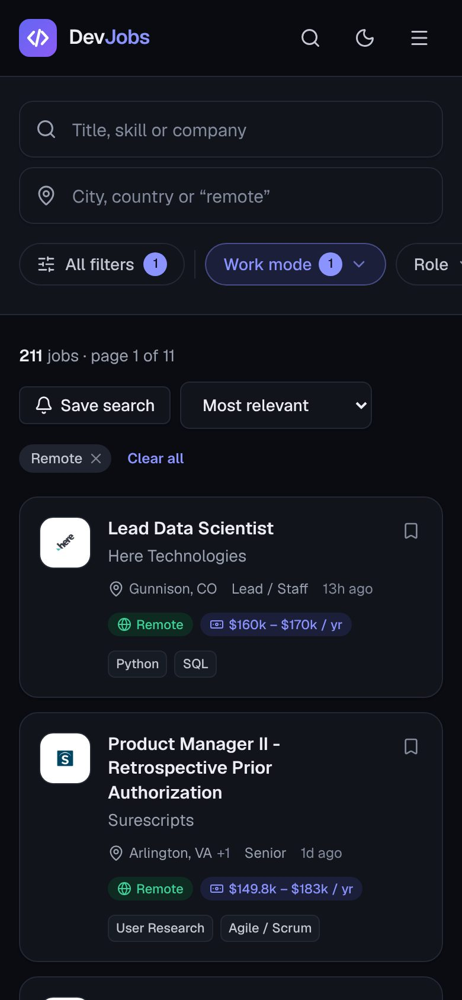
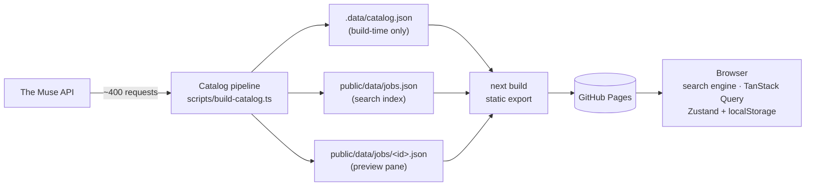

# DevJobs

**A static-first job board for tech roles — real listings, instant faceted search, skill-match scores and a Kanban application tracker, with light, dark and system themes.**

No servers at runtime: a data pipeline turns a noisy public API into a clean catalog at build time, Next.js exports every page as static HTML, and everything interactive runs in the browser. It's hosted for free on GitHub Pages and refreshes itself every six hours.

**Live:** https://iabolfazl83.github.io/devjobs/ — click **“Try the demo account”** to see a fully populated dashboard and tracker in one click.

[](https://github.com/iabolfazl83/devjobs/actions/workflows/deploy.yml)

| Light | Dark |
|---|---|
|  |  |
|  |  |
|  |  |
|  |  |

> Explaining this project to an interviewer or client? See **[docs/INTERVIEW-GUIDE.md](docs/INTERVIEW-GUIDE.md)** — a pitch, a demo script, and the reasoning behind every major decision.

---

## Features

**Search & discovery**
- Full-text search with prefix matching and field weighting (title › skills/company › role › location)
- Facets for role, seniority, work mode, skills, date posted and salary — with **live, disjunctive counts**
- Split view like LinkedIn/Indeed: results on the left, full job preview on the right (desktop)
- Every search is a URL — shareable, bookmarkable, and the Back button works
- `⌘K` / `Ctrl+K` command palette to jump to jobs, companies, pages or switch theme
- Company directory and company profiles with all their open roles

**Personalization**
- Profile with roles, skills, seniority and work-mode preferences (guided onboarding after sign-up)
- **Match score** on every job — and exactly which of the job's skills you have and which you're missing
- Recommendations ranked by fit; saved searches that count **new matches since you last looked**

**Application tracker**
- Kanban board: Saved → Applied → Interviewing → Offer → Closed
- Drag and drop, plus a keyboard/touch-friendly “Move to” menu on every card
- Notes with autosave, a status timeline, list view, undo on removals
- “Did you apply?” prompt when you come back from an employer's page

**Experience**
- Three themes — light, dark, system — applied before first paint (no flash), synced across tabs
- Responsive from 360px phones to wide desktops; accessible (axe-checked in both themes)
- Demo-grade accounts: sign up, sign in, edit profile, export/import/delete your data

## How it works



1. **Extract** — fetch a fixed plan of job pages (by category, location, level) plus page 0 for every tech company in The Muse's directory.
2. **Transform** — the upstream categories are unreliable (“Produce Associate” is filed under *Software Engineering*), so a rule-based classifier assigns roles from titles, rejects non-tech and hardware roles, and requires description evidence for ambiguous titles. It also extracts skills (~90-entry dictionary), salary ranges, seniority and work mode, dedupes re-posts, drops stale listings and caps any one employer at 20 jobs.
3. **Load** — write a full catalog for the build and two small artifacts for the browser.

Typical run: ~4,200 rows fetched → ~800 published from ~130 companies. The **“How it's built”** page on the live site shows the real numbers for the current build.

### Rendering strategy

| Route | Strategy | Why |
|---|---|---|
| `/` | Static (SSG) | Stats, roles, skills and companies baked in at build time |
| `/jobs/[id]` | Static, one page per job | Real HTML + schema.org `JobPosting` for SEO |
| `/companies`, `/companies/[slug]` | Static | Directory filters in memory; profiles pre-rendered |
| `/jobs` | Static shell + client search | Results depend on URL params a static page can't know |
| `/dashboard`, `/tracker`, `/profile` | Client, behind a route guard | Personal data only exists in the browser |

### Key decisions

- **Static-first.** GitHub Pages only serves files — the previous SQLite/API-route version of this app couldn't run there. Now the only runtime is the browser.
- **Server state vs client state.** TanStack Query owns fetched data; Zustand owns session/tracker state, persisted to `localStorage` and hydrated *after* mount so static HTML and React never disagree.
- **A mock backend shaped like a real one.** Auth and tracker logic live behind async functions returning result objects, over pure, unit-tested reducers. Swapping `localStorage` for a real API is a one-file change.
- **Security hygiene in a demo.** DOMPurify at build time for third-party HTML; PBKDF2 password hashing with per-user salts and constant-time comparison; no user enumeration on login; open-redirect-safe `?next=`.
- **Measured, not assumed.** Theme tokens checked for WCAG AA contrast; chart colors run through a palette validator; axe-core audits in CI.

## Tech stack

Next.js 16 (App Router, `output: "export"`) · React 19 + React Compiler · TypeScript (strict) · Tailwind CSS v4 · TanStack Query · Zustand · DOMPurify · Web Crypto · lucide-react · Vitest · Playwright + axe-core · GitHub Actions + Pages

## Project structure

```
scripts/
  build-catalog.ts        Data pipeline: fetch → transform → write JSON
  serve-static.mjs        Serves out/ like GitHub Pages (preview + e2e)
src/
  app/                    Routes (App Router)
  components/             UI, grouped by feature (jobs, search, tracker, …) + ui/ primitives
  lib/
    catalog/              Domain model, classifier, skills, salary, transform (pure + tested)
    search/               Search engine, URL params, match scoring (pure + tested)
    auth/                 Mock auth service, hashing, validation, hooks
    tracker/              Tracker reducers (pure + tested), store, demo seed
    server/catalog.ts     Build-time catalog access (server-only)
    data/queries.ts       TanStack Query definitions
e2e/                      Playwright specs (incl. accessibility + mobile)
.github/workflows/        CI & deploy
```

## Getting started

Requires Node 22.

```bash
git clone https://github.com/iabolfazl83/devjobs.git
cd devjobs
npm install
npm run dev        # fetches the job catalog first (cached for 6h), then starts Next.js
```

Open http://localhost:3000.

| Script | What it does |
|---|---|
| `npm run dev` | Build the catalog if stale, start the dev server |
| `npm run catalog` | Run the data pipeline (`-- --refresh` to force, `-- --offline` to reuse cached raw data) |
| `npm run build` | Pipeline + static export to `out/` |
| `npm run preview` | Serve `out/` locally (set `NEXT_PUBLIC_BASE_PATH` to match the build) |
| `npm test` | Unit tests (Vitest) |
| `npm run test:e2e` | End-to-end + accessibility tests against the built site (Playwright) |
| `npm run lint` / `npm run typecheck` | ESLint (incl. React Compiler rules) / TypeScript |

To run the e2e suite exactly as CI does:

```bash
NEXT_PUBLIC_BASE_PATH=/devjobs npm run build
npx playwright install chromium   # first time only
npm run test:e2e
```

## Deployment (GitHub Pages)

The workflow in `.github/workflows/deploy.yml` lints, type-checks, unit-tests, builds, runs the e2e suite, and deploys `out/` to Pages — on every push to `master` and **every 6 hours** to refresh the catalog. PRs run everything except the deploy.

One-time setup:
1. **Settings → Pages → Build and deployment → Source: GitHub Actions** (it currently shows the README via Jekyll).
2. *Optional:* add a repository secret `MUSE_API_KEY` (free from The Muse) to raise the API rate limit.

If the upstream API fails, the pipeline falls back to the last cached snapshot, so a bad upstream day never breaks the site.

## Known limitations

- **Accounts are demo-only.** They live in your browser's `localStorage`; anything client-side is readable by the user, so this demonstrates auth *flows* and hygiene, not real security.
- **Search covers the snapshot**, not all of The Muse — currently ~800 curated tech jobs, refreshed every 6 hours.
- **Classification is heuristic.** It's tested and errs toward dropping ambiguous roles, but it isn't perfect.
- **Salary appears only when the listing states a range** (about a third of jobs, mostly US pay-transparency disclosures).
- GitHub disables scheduled workflows after 60 days without repository activity; a push re-enables the refresh.

## What I'd build next

- Real auth and sync (e.g. Supabase) behind the existing service layer
- Email alerts for saved searches, sent from the scheduled pipeline run
- An inverted index in a Web Worker if the catalog grows past ~50k jobs

---

Job data from [The Muse](https://www.themuse.com/developers/api/v2). Company logos belong to their owners.
